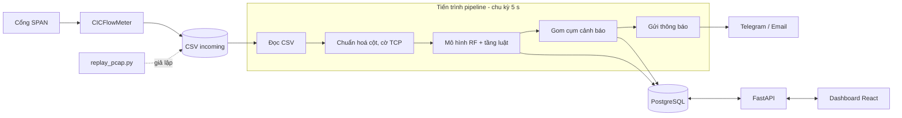
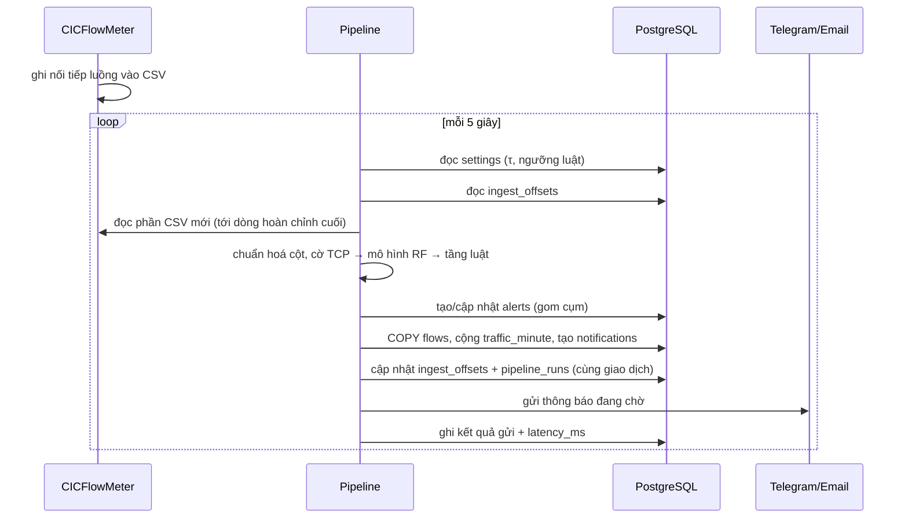
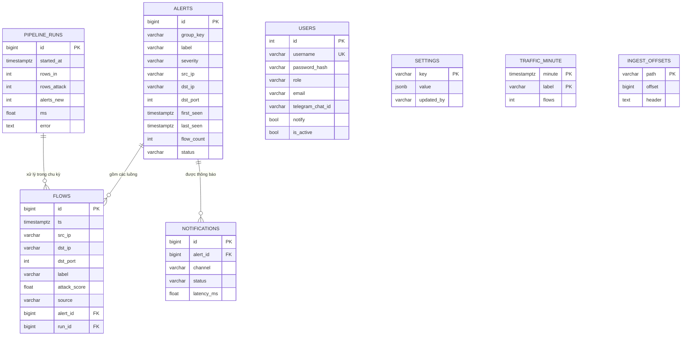

# Kế hoạch chỉnh sửa báo cáo khoá luận — đến hết tuần 9

Tài liệu dùng để cả nhóm sửa **Báo cáo 1** (`KLHK1262721_BC1_...docx`, gồm Phần mở đầu và Chương 1–3) thành bản báo cáo cập nhật đến hết tuần 9. Đối chiếu với **Đề cương chi tiết** (`DE_CUONG_CHI_TIET.md` / `DeCuong_ChinhThuc.docx`) và với mã nguồn hiện có (`backend/`, `frontend/`, `Test_Kich_Ban_C/`).

Mọi số liệu và mô tả hệ thống ở đây lấy từ mã nguồn và kết quả đã chạy. Khi viết vào báo cáo, **không thêm chức năng chưa làm**. Phần nào chưa làm thì ghi rõ "chưa thực hiện" hoặc "hướng phát triển".

---

## 1. Tiến độ đến tuần 9 so với kế hoạch trong đề cương

| # | Công việc (đề cương mục V) | Tuần theo kế hoạch | Tình trạng thực tế | Đã có trong BC1? |
|---|---|---|---|---|
| 1 | Nghiên cứu lý thuyết | 1–3 | Xong | Có (Chương 1, 2) |
| 2 | Khảo sát yêu cầu, xác định phạm vi | 1–3 | Bài toán đã xác định; **yêu cầu hệ thống chưa viết** | Thiếu → viết ở mục 4.1 mới |
| 3 | Lab mô phỏng và kịch bản tấn công | 3–5 | **Chưa có lab 3 VLAN/pfSense**; kịch bản C dùng 4 file pcap mẫu | BC1 mô tả lab như đã có → phải sửa |
| 4 | Thu thập, tiền xử lý dữ liệu, chọn đặc trưng | 4–7 | Xong (F_NOOS 56 đặc trưng) | Có |
| 5 | Huấn luyện, so sánh, chọn mô hình | 6–10 | Kịch bản A, B, C xong; **chốt RF** (τ = 0,48); **chưa có Isolation Forest** | Thiếu kịch bản C |
| 6 | Thiết kế kiến trúc hệ thống và CSDL | 4–6 | Đã cài đặt xong | **Chưa có** → Chương 4 mới |
| 7 | Pipeline xử lý theo lô và suy luận | 7–10 | Đã có mã nguồn, chạy được | Chưa có |
| 8 | Backend: API, CSDL, cảnh báo, phân quyền | 7–11 | Đã có phần lớn | Chưa có |
| 9 | Frontend dashboard | 8–12 | Đã có 5 màn hình | Chưa có |
| 10–11 | Tích hợp, kiểm thử, đánh giá trên lab | 11–14 | Có 11 test tự động; chưa đo độ trễ và thông lượng | Để khung Chương 5 |
| — | Đóng gói Docker Compose | — | **Chưa làm** (đang chạy bằng script PowerShell) | BC1 viết như đã có → phải sửa |

**Kết luận:** bản tuần 9 cần (1) sửa các chỗ BC1 mô tả sai so với thực tế, (2) bổ sung kịch bản C vào Chương 3, (3) viết mới **Chương 4 – Phân tích và thiết kế hệ thống** (kiến trúc, CSDL, backend, frontend), (4) dựng khung Chương 5.

---

## 2. Cấu trúc báo cáo đề xuất (bản tuần 9)

```
PHẦN MỞ ĐẦU                                   (sửa — mục 3 của tài liệu này)
CHƯƠNG 1. Tổng quan                            (sửa nhỏ: 1.3.3, 1.4.3)
CHƯƠNG 2. Cơ sở lý thuyết và phương pháp       (bổ sung 2.8 Gom cụm cảnh báo và tầng luật)
CHƯƠNG 3. Thực nghiệm, so sánh, lựa chọn mô hình
          + 3.9  Kịch bản C (MỚI)
          + 3.10 Hệ lai mô hình + tầng luật (MỚI)
          + 3.11 Chốt mô hình triển khai (thay 3.8.5)
CHƯƠNG 4. Phân tích và thiết kế hệ thống       (MỚI — mục 5 của tài liệu này)
          4.1 Yêu cầu hệ thống
          4.2 Kiến trúc tổng thể
          4.3 Thiết kế cơ sở dữ liệu
          4.4 Thiết kế backend
          4.5 Thiết kế frontend
          4.6 Môi trường cài đặt và vận hành
CHƯƠNG 5. Triển khai, kiểm thử và đánh giá     (KHUNG — điền ở tuần 11–14)
KẾT LUẬN VÀ HƯỚNG PHÁT TRIỂN
TÀI LIỆU THAM KHẢO, PHỤ LỤC
```

Sau khi thêm mục mới, nhớ đánh lại số các mục cũ (3.9 Hạn chế → 3.12, 3.10 Tiểu kết → 3.13; mục 2.8 Kết chương 2 → 2.9).

---

## 3. Những chỗ BC1 phải sửa

### 3.1. Nội dung sai hoặc lệch so với hệ thống thực tế

| Vị trí trong BC1 | Đang viết | Thực tế | Sửa thành |
|---|---|---|---|
| Phần mở đầu, mục 2 "Mục đích" | "Hệ thống phải phát hiện được cả các biến thể mới… và zero-day" | Kịch bản B: tỉ lệ phát hiện ≤ 15% khi dùng argmax; Isolation Forest chưa làm | Hạ xuống thành mục tiêu nghiên cứu: "đánh giá khả năng phát hiện biến thể mới" (đã có số liệu kịch bản B, C) |
| Mở đầu mục 3, 6; mục 1.3.2; 1.3.3; 1.5; 2.6.4; Bảng 2.7 | Isolation Forest là một thành phần của hệ thống | Chưa huấn luyện, chưa tích hợp | Chuyển thành **hướng mở rộng**, hoặc làm kịp trước khi nộp (xem mục 7) |
| 1.3.3 | "Suy luận mô hình (FastAPI)" | Suy luận chạy trong **tiến trình pipeline** riêng; FastAPI chỉ phục vụ dashboard (và API tải CSV lên phân tích thử) | "Pipeline theo lô (5 s) → mô hình + tầng luật → PostgreSQL → FastAPI → Dashboard" |
| 1.3.3 | "Song song với mô hình phân loại, mô hình không giám sát chấm điểm bất thường…" | Không có | Thay bằng **tầng luật theo nguồn** (thành phần thực sự chạy song song với mô hình) |
| 1.4.3, gạch đầu dòng cuối | "đóng gói Docker Compose" | Chưa có Docker; chạy bằng `scripts/setup.ps1`, `start.ps1` | Bỏ chữ Docker, hoặc làm Docker trước khi nộp |
| 1.4.3; 2.3 (Bảng 2.4); 2.3 đoạn cuối | "lab mô phỏng đa VLAN (pfSense, hping3, nmap, hydra)" | Kịch bản C dùng 4 pcap mẫu: `benign`, `ddos` (phản xạ UDP memcached/NTP/CLDAP), `portscan` (nmap SYN 65.535 cổng), `bruteforce` (hydra SSH) | Ghi đúng nguồn dữ liệu; lab 3 VLAN chuyển thành "đang triển khai" hoặc hướng phát triển |
| 2.2 | Không nói gì về quy ước cờ TCP | Dữ liệu huấn luyện ghi cờ TCP **dạng nhị phân và lệch cột**; nếu đếm cờ đúng chuẩn thì PortScan rơi về 0% | Thêm mục 2.2.x "Khớp đặc trưng với CICFlowMeter" (xem 4.1 của tài liệu này) |
| 3.8.5 | "Định hướng hiện tại là dùng LightGBM", "chưa chốt mô hình" | Kịch bản C đã chạy, theo đúng quy tắc 3.8.5 → **chuyển sang Random Forest**, τ\* = 0,48 | Viết lại thành mục "Chốt mô hình triển khai" |
| Phân công (Bảng 0.5), Trương Nguyễn Đức Anh | "Đóng gói… bằng Docker/Docker Compose" | Chưa làm | Giữ nếu sẽ làm, không thì sửa |
| Mọi chỗ ghi tên nhãn | Lẫn lộn `DDoS`, `DDOS`, `DoS/DDoS` | Mô hình và CSDL dùng **`DoS/DDoS`, `PortScan`, `BruteForce`, `BENIGN`** | Thống nhất 4 tên này trong toàn bài |

### 3.2. Lỗi hình thức

- **Bảng 3.9 chưa có**: danh mục bảng ghi "[Bổ sung tiêu đề bảng 3.9…]", mục 3.8.2 lại tham chiếu tới Bảng 3.9. Hoặc tạo bảng (so sánh từng bước của luật chọn), hoặc sửa tham chiếu thành Bảng 3.8.
- **Mục 3.8 thiếu tiêu đề 3.8.1–3.8.4**: chỉ có 3.8.2, 3.8.3 dạng chữ thường và 3.8.5 dạng heading. Đặt heading cho đủ.
- **Bảng 0.4 không tồn tại**: danh mục nhảy từ 0.3 sang 0.5.
- **Mở đầu mục 6 có a, c, d nhưng thiếu b.**
- **Tham chiếu hỏng:**
  - 1.3.3 trỏ tới "mục 2.2.3", nhưng mục 2.2 không có mục con.
  - 2.1 (dưới Bảng 2.1) trỏ tới "bước gom cụm cảnh báo (mục 2.7)", nhưng 2.7 là chỉ số đánh giá. Mở đầu Chương 2 hứa "(v) thuật toán tương quan gom cụm" nhưng chương không có mục này. Cần viết mục 2.8 mới (xem 4.2).
  - 3.4 trỏ tới "Phụ lục A, Bảng A.3", nhưng báo cáo chưa có phụ lục.
- **Danh mục hình** mới có 3 hình. Chương 4 cần thêm khoảng 8–10 hình (mục 5.7).
- **Không chép từ `baocao schema.docx` và `DATA_CONTRACT_v1.md`**: hai file này là bản cũ (60 đặc trưng, SMOTE, chia theo thời gian, nhãn `DDoS`), mâu thuẫn với BC1 (56 đặc trưng F_NOOS, class weight, Group 5-fold).

---

## 4. Bổ sung Chương 2 và Chương 3

### 4.1. Mục 2.2.x (mới) — Khớp đặc trưng với CICFlowMeter

Nguồn: `Test_Kich_Ban_C/results/Bao_Cao_Kich_Ban_C.md` mục 2, `Test_Kich_Ban_C/pcap_flow_extractor.py`, `backend/engine/cic_compat.py`.

Nội dung cần viết:
1. Khi tự trích xuất luồng từ pcap phải tái hiện đúng cách CICFlowMeter tính: độ dài gói tính cả phần đệm Ethernet; header TCP lấy độ dài thật (20/24/32/40 byte), UDP = 8; Active/Idle chỉ ghi khi có khoảng nghỉ > 5 s.
2. **Phát hiện quan trọng:** trong dữ liệu huấn luyện, cờ TCP là nhị phân và bị ghi lệch cột (`SYN Flag Count` trùng 100% với `Fwd PSH Flags`, `RST Flag Count` trùng 100% với `ECE Flag Count`). Đưa vào báo cáo quy tắc ánh xạ suy ra được.
3. Hệ quả (Bảng 6 của báo cáo kịch bản C): nếu đếm cờ đúng chuẩn, AUC của RF giảm từ 0,998 xuống 0,619 và PortScan từ 99,95% xuống 0%.
4. Cách xử lý trong hệ thống: `cic_compat.py` có chế độ `FLAG_MODE = auto | cic2017 | standard`, tự nhận biết rồi chuyển về quy ước lúc huấn luyện.

### 4.2. Mục 2.8 (mới) — Gom cụm cảnh báo và tầng luật theo nguồn

Mục này lấp chỗ trống mà mở đầu Chương 2 đã hứa. Chỉ viết phần lý thuyết và thuật toán; phần cài đặt để ở Chương 4.

**a. Tầng luật theo nguồn** (`engine/ids_rules.py`). Lý do: một số dấu hiệu chỉ thấy khi gom nhiều luồng (Bảng 2.1). Có hai luật, dùng cửa sổ trượt theo IP nguồn:

| Luật | Điều kiện | Cửa sổ | Ngưỡng sàn |
|---|---|---|---|
| BruteForce | ≥ M phiên TCP mới từ một nguồn tới **cùng một cổng đăng nhập** của cùng một đích. Các cổng: 21, 22, 23, 110, 143, 389, 445, 1433, 3306, 3389, 5432, 5900 | 60 s | M ≥ 10 |
| PortScan (dự phòng) | ≥ N cổng khác nhau của cùng một đích | 10 s | N ≥ 20 |

Luật **chỉ bổ sung**: chỉ áp dụng cho luồng mà mô hình cho là BENIGN, hoặc luồng mô hình không chấm được (luồng 1 gói, thời lượng = 0). Luật không ghi đè nhãn tấn công do mô hình đưa ra.

**b. Gom cụm cảnh báo** (`pipeline/aggregator.py`). Mỗi lượt tấn công thành **một** cảnh báo, theo khoá gom:

| Nhãn | Khoá gom | Mức độ |
|---|---|---|
| DoS/DDoS | (nhãn, IP đích) — nhiều nguồn dồn về một đích; đếm số nguồn `src_count` | cao |
| PortScan | (nhãn, IP nguồn, IP đích) | trung bình |
| BruteForce | (nhãn, IP nguồn, IP đích, cổng) | cao |

Luồng mới cùng khoá, đến trong vòng `idle` giây (mặc định 120 s) kể từ luồng cuối, được cộng vào cảnh báo đang mở. Quá `idle` giây không có luồng mới thì cảnh báo tự đóng. Thời gian tính theo **thời gian của luồng**, nên phát lại pcap cũ vẫn gom đúng.

### 4.3. Mục 3.9 (mới) — Kịch bản C

Nguồn số liệu: `Test_Kich_Ban_C/results/Bao_Cao_Kich_Ban_C.md` và các file `.csv` cùng thư mục.

- **Dữ liệu:** 4 pcap, số luồng đánh giá: BENIGN 1.880, DoS/DDoS 1.724, PortScan 65.535, BruteForce 480. Ghi rõ số luồng bị loại do thời lượng = 0 (BruteForce mất 475/955).
- **Phương pháp:** 200 lần chia đôi theo tầng nhãn. Nửa thứ nhất hiệu chỉnh τ\* (τ nhỏ nhất thoả FPR ≤ 1%), nửa thứ hai đánh giá. Báo cáo trung vị và khoảng 95%.
- **Bảng kết quả mô hình đơn lẻ** (chép bảng mục 4 của báo cáo kịch bản C, chỉ lấy LightGBM, RF, XGBoost):

| Mô hình | AUC | τ\* | FPR | DR | DoS/DDoS | PortScan | BruteForce |
|---|---|---|---|---|---|---|---|
| LightGBM | 0,9953 | 0,52 | 0,96% | 96,27% | 53,89% | 98,00% | 10,83% |
| Random Forest | 0,9981 | 0,48 | 0,21% | 99,06% | 92,81% | 99,95% | 0% |
| XGBoost | 0,9986 | 0,67 | 0,96% | 97,61% | 22,27% | 99,97% | 46,88% |

- **Nhận xét cần viết:** cả ba mô hình đều bỏ sót BruteForce (RF bỏ sót toàn bộ). DoS/DDoS phản xạ UDP thì RF tốt nhất, khớp với kết quả AUC ở chiều CIC-DDoS2019 của kịch bản B (0,96).

### 4.4. Mục 3.10 (mới) — Hệ lai mô hình + tầng luật

| Hệ | FPR | DR | DR trung bình theo lớp | DoS/DDoS | PortScan | BruteForce |
|---|---|---|---|---|---|---|
| LightGBM + luật | 0,96% | 98,80% | 83,80% | 53,89% | 100% | 97,50% |
| **RF + luật** | **0,21%** | **99,80%** | **96,77%** | 92,81% | 100% | 97,50% |
| XGBoost + luật | 0,96% | 98,01% | 73,43% | 22,27% | 100% | 98,12% |

Ý chính: luật bù đúng điểm yếu của mô hình theo từng luồng (BruteForce từ 0% lên 97,5% với RF) mà không làm tăng FPR. Đây là đóng góp mới so với BC1, cần đưa vào mục 1.4.3 và phần Kết luận.

### 4.5. Mục 3.11 — Chốt mô hình triển khai (thay mục 3.8.5)

- Áp quy tắc đã cố định từ BC1: ΔAUC (RF − LightGBM) = +0,0030; ΔDR = +2,80 điểm %. Mức chênh DR vượt ngưỡng 2 điểm → **chuyển sang Random Forest** (`rf_F_NOOS.joblib`, τ = 0,48).
- **Phải viết trung thực:** RF chỉ thoả điều kiện chuyển ở **60%** số lần chia, và `ddos.pcap` không có SYN flood như quy tắc 3.8.5 yêu cầu. Kết luận là "chọn RF theo quy tắc, với độ chắc chắn vừa phải".
- Ghi rõ giới hạn (mục 9 của báo cáo kịch bản C): không phải dữ liệu lab; ngưỡng BruteForce chưa thử với người dùng SSH thật.
- **Cần chạy lại trước khi chép số:** kịch bản C đang chạy với scikit-learn **1.9.1**, còn mô hình huấn luyện và backend dùng **1.6.1**. Chạy lại `test_lab_3_models.py` bằng môi trường `backend/.venv` (1.6.1) rồi mới chép số vào báo cáo.

---

## 5. Chương 4 (mới) — Phân tích và thiết kế hệ thống

### 4.1. Yêu cầu hệ thống

**Tác nhân:**

| Tác nhân | Mô tả | Trong hệ thống |
|---|---|---|
| Quản trị viên | Cấu hình ngưỡng, thông báo, người dùng | vai trò `admin` |
| Người giám sát (SOC) | Xem dashboard, xác nhận và đóng cảnh báo | vai trò `viewer` |
| Sensor CICFlowMeter | Ghi luồng vào CSV | thư mục `backend/data/incoming` |
| Telegram / máy chủ SMTP | Nhận thông báo | dịch vụ ngoài |

> Đề cương ghi 3 vai trò (Admin/Analyst/Viewer); hệ thống có 2. Trong báo cáo, giải thích rằng vai trò `viewer` đã gồm quyền xử lý cảnh báo (tức là Analyst), nên gộp Analyst và Viewer. Nếu nhóm muốn đủ 3 vai trò thì cần sửa code.

**Yêu cầu chức năng.** Mã nguồn đang dùng các mã CN1, CN4, CN6, CN7. Danh sách đầy đủ dưới đây là đề xuất, cả nhóm thống nhất rồi dùng chung cho Chương 4 và Chương 5:

| Mã | Yêu cầu | Thành phần đáp ứng | Bằng chứng kiểm thử |
|---|---|---|---|
| CN1 | Pipeline chạy định kỳ 5 s, không bỏ chu kỳ | `pipeline/run.py` | bảng `pipeline_runs`; ô "Pipeline 10 phút" ở Tổng quan |
| CN2 | Đọc luồng từ CSV của CICFlowMeter, không mất, không trùng dòng (kể cả file đang ghi dở, kể cả khi khởi động lại) | `pipeline/ingest.py` | bảng `ingest_offsets`; test `test_incremental_append` |
| CN3 | Phân loại 4 lớp bằng mô hình + tầng luật | `engine/analyzer.py` | test `test_detection_matches_scenario_c` |
| CN4 | Mỗi lượt tấn công sinh ít cảnh báo (gom cụm) | `pipeline/aggregator.py` | test `test_pipeline_creates_one_alert_per_attack` |
| CN5 | Dashboard: tổng quan, danh sách và chi tiết cảnh báo, xác nhận và đóng | `app/api/stats.py`, `alerts.py`, frontend | test `test_api_flow` |
| CN6 | Thông báo Telegram/Email, ghi độ trễ | `pipeline/notifier.py` | bảng `notifications.latency_ms` |
| CN7 | Đổi ngưỡng τ, ngưỡng luật, thông báo **lúc đang chạy**, không phải khởi động lại | `app/runtime_settings.py`, bảng `settings` | test `test_settings_validation` |
| CN8 | Đăng nhập, quản lý người dùng, phân quyền | `app/api/auth.py`, `admin.py` | test `test_auth_and_roles` |

**Yêu cầu phi chức năng:** chu kỳ xử lý ≤ 5 s; mật khẩu băm bcrypt; xác thực JWT (hết hạn sau 720 phút); luồng lưu 7 ngày, nhật ký chu kỳ lưu 30 ngày; giao diện tiếng Việt; mỗi chu kỳ đọc tối đa 64 MB CSV để không bị nghẽn khi có đợt tấn công lớn.

**So với đề cương, chưa làm (ghi vào "Hạn chế" hoặc làm thêm):**
- Nhật ký hoạt động (audit log): hiện chỉ lưu `ack_by`/`ack_at` trên cảnh báo và `updated_by` trên cấu hình.
- Trạng thái "báo động giả": hiện có `open`, `ack`, `closed`; báo động giả đang ghi vào ô ghi chú khi đóng.
- Danh sách trắng IP; trang phân tích mô hình (confusion matrix, feature importance); xuất báo cáo PDF/CSV.

**Hình cần vẽ:** Hình 4.1 – Biểu đồ use case (2 tác nhân người dùng, khoảng 10 use case).

### 4.2. Kiến trúc tổng thể

```
 Cổng SPAN ──► CICFlowMeter ──► backend/data/incoming/*.csv
                                     ▲            │ mỗi 5 s
       tools/replay_pcap.py ─────────┘            ▼
       (giả lập sensor từ pcap)          ┌──────────────────────── Tiến trình PIPELINE ───────────────────────┐
                                         │ ingest → cic_compat → Analyzer (RF + tầng luật) → aggregator         │
                                         │                                    │                    │            │
                                         │                                    ▼                    ▼            │
                                         │                            ghi flows (COPY)      notifier ──► Telegram │
                                         └────────────────────────────────────┼─────────────────────────► Email  ┘
                                                                              ▼
                                                                         PostgreSQL 16
                                                                              ▲
                                         ┌──────────── Tiến trình API (FastAPI, cổng 8000) ────────────┐
                                         │ auth · stats · alerts · admin · system  (JWT, phân quyền)   │
                                         └──────────────────────────────▲──────────────────────────────┘
                                                                        │ REST/JSON, tự làm mới 5 s
                                                          Dashboard React (cổng 5173)
```

Mermaid để vẽ lại Hình 4.2 (dán vào https://mermaid.live rồi xuất PNG):



**Các quyết định thiết kế cần giải thích trong báo cáo:**
1. **Xử lý theo lô 5 s thay vì streaming (Kafka):** đủ cho yêu cầu gần thời gian thực, hệ thống đơn giản hơn (đề cương đã nêu lý do này).
2. **Tách pipeline và API thành 2 tiến trình:** API không bị chậm khi pipeline đang chấm hàng chục nghìn luồng; pipeline lỗi thì dashboard vẫn xem được dữ liệu cũ. Hai tiến trình chỉ giao tiếp qua CSDL.
3. **Giao tiếp sensor ↔ pipeline qua thư mục CSV:** CICFlowMeter vốn ghi CSV, nên không phải sửa sensor. Khi chưa có sensor thì dùng `replay_pcap.py` thay thế, cho kết quả lặp lại được khi demo.
4. **Cấu hình chia hai lớp:** cấu hình tĩnh trong `.env` (chuỗi kết nối CSDL, đường dẫn mô hình, khoá JWT) và cấu hình lúc chạy trong bảng `settings` (τ, ngưỡng luật, thông báo), pipeline đọc lại mỗi chu kỳ.

**Một chu kỳ pipeline** (Hình 4.3, biểu đồ tuần tự):



Điểm cần nhấn mạnh: vị trí đã đọc (`ingest_offsets`) được ghi **trong cùng giao dịch** với dữ liệu luồng. Nếu chu kỳ lỗi thì toàn bộ được rollback, chu kỳ sau đọc lại từ đúng vị trí cũ, nên không mất và không trùng dòng (CN2).

### 4.3. Thiết kế cơ sở dữ liệu

PostgreSQL 16, database `ids`, 8 bảng, tạo bằng SQLAlchemy (`backend/app/models.py`, lệnh `python -m app.seed`). Hướng dẫn kết nối: `backend/HUONG_DAN_KET_NOI_SQL.md`.

**Nhóm bảng:**

| Nhóm | Bảng | Vai trò |
|---|---|---|
| Dữ liệu giám sát | `flows`, `alerts`, `traffic_minute` | Luồng đã gán nhãn, cảnh báo đã gom, thống kê theo phút |
| Vận hành | `pipeline_runs`, `notifications`, `ingest_offsets` | Nhật ký chu kỳ, lịch sử gửi thông báo, vị trí đã đọc CSV |
| Quản trị | `users`, `settings` | Tài khoản, cấu hình lúc chạy |

**Sơ đồ quan hệ** (Hình 4.4 – ERD):



Khoá ngoại: `flows.alert_id → alerts` (khi xoá cảnh báo thì đặt NULL), `flows.run_id → pipeline_runs` (đặt NULL), `notifications.alert_id → alerts` (xoá theo, CASCADE). Bảng `users` không có khoá ngoại: `alerts.ack_by` và `settings.updated_by` lưu tên đăng nhập để giữ lịch sử kể cả khi tài khoản bị xoá.

**Đặc tả từng bảng** (đưa vào báo cáo dạng Bảng 4.x):

`users` — tài khoản dashboard

| Cột | Kiểu | Ý nghĩa |
|---|---|---|
| id | integer, PK | |
| username | varchar(50), unique | tên đăng nhập |
| password_hash | varchar(100) | băm bcrypt |
| role | varchar(10) | `admin` \| `viewer` |
| full_name, email | varchar | họ tên, email nhận cảnh báo |
| telegram_chat_id | varchar(40) | chat id nhận cảnh báo Telegram |
| notify | boolean | có nhận thông báo hay không |
| is_active | boolean | khoá/mở tài khoản |
| created_at | timestamptz | |

`settings` — cấu hình lúc chạy (key–value, giá trị JSONB)

| Cột | Kiểu | Ý nghĩa |
|---|---|---|
| key | varchar(50), PK | tên tham số |
| value | jsonb | giá trị |
| updated_by, updated_at | | ai sửa, lúc nào |

Có 14 khoá: `tau` (mặc định 0,48), `ps_min` (20), `bf_min` (10), `alert_idle_seconds` (120), `notify_min_severity` (`medium`), `telegram_enabled`, `telegram_bot_token`, `email_enabled`, `smtp_host`, `smtp_port`, `smtp_user`, `smtp_password`, `smtp_from`, `smtp_starttls`. Hai khoá bí mật (token Telegram, mật khẩu SMTP) bị che thành `******` khi API trả về.

`pipeline_runs` — mỗi chu kỳ pipeline một dòng (bằng chứng CN1)

| Cột | Ý nghĩa |
|---|---|
| id, started_at, finished_at | |
| files | các file CSV đã đọc trong chu kỳ |
| rows_in, rows_valid, rows_attack | số luồng vào, hợp lệ, bị gán nhãn tấn công |
| alerts_new, alerts_updated | số cảnh báo mới và cập nhật |
| flag_mode, tau | quy ước cờ TCP đã nhận biết, ngưỡng đang dùng |
| ms | thời gian xử lý chu kỳ (dùng để đo hiệu năng ở Chương 5) |
| error | thông báo lỗi nếu chu kỳ lỗi |

`alerts` — một lượt tấn công một cảnh báo (CN4)

| Cột | Ý nghĩa |
|---|---|
| id | |
| group_key | khoá gom (ví dụ `PortScan\|10.0.0.5\|10.0.0.9\|*`) |
| label | `DoS/DDoS` \| `PortScan` \| `BruteForce` |
| severity | `high` \| `medium` \| `low` |
| src_ip, dst_ip, dst_port | nguồn – đích (DoS/DDoS không có src_ip vì nhiều nguồn) |
| first_seen, last_seen | thời điểm luồng đầu và luồng cuối |
| flow_count, src_count | số luồng, số IP nguồn |
| max_score | điểm tấn công cao nhất (1 − P(BENIGN)) |
| source | `model` \| `rule` \| `model+rule` |
| rule_detail | mô tả luật đã kích hoạt (ví dụ "35 phiên tới cổng 22 / 60 s (ngưỡng 10)") |
| status | `open` \| `ack` \| `closed` |
| note, ack_by, ack_at, closed_at | xử lý của người giám sát |
| created_at, updated_at | (`created_at` dùng để tính độ trễ thông báo) |

Chỉ mục: `group_key`, `label`, `last_seen`, `status`.

`flows` — từng luồng đã gán nhãn

| Cột | Ý nghĩa |
|---|---|
| id, ts | thời điểm bắt đầu luồng |
| src_ip, src_port, dst_ip, dst_port, protocol | định danh 5-tuple (chỉ làm siêu dữ liệu, **không** đưa vào mô hình) |
| duration_us, fwd_pkts, bwd_pkts, fwd_bytes, bwd_bytes | vài đặc trưng tóm tắt để hiển thị (không lưu đủ 56 đặc trưng để tiết kiệm dung lượng) |
| valid | luồng có chấm được không (thời lượng > 0, không thiếu hoặc vô hạn giá trị) |
| label | nhãn cuối cùng; NULL nếu không hợp lệ |
| attack_score | 1 − P(BENIGN) |
| source, rule_detail | phát hiện bởi mô hình hay luật |
| alert_id, run_id | FK |

Chỉ mục: `ts`, `(label, ts)`, `alert_id`, `(src_ip, ts)`. Luồng tự xoá sau `FLOW_RETENTION_DAYS` = 7 ngày.

`traffic_minute` — số luồng theo phút × nhãn (khoá chính ghép `minute`, `label`; nhãn gồm thêm `INVALID`). Đây là bảng **tổng hợp trước** để trang Tổng quan không phải quét bảng `flows` (hàng triệu dòng). Cập nhật bằng `INSERT … ON CONFLICT DO UPDATE` (upsert).

`notifications` — mỗi lần gửi một dòng: `alert_id`, `channel` (`telegram`|`email`), `recipient`, `status` (`pending`|`sent`|`failed`), `error`, `created_at`, `sent_at`, `latency_ms` (tính từ lúc tạo cảnh báo, dùng đo CN6).

`ingest_offsets` — `path` (PK, đường dẫn file CSV), `offset` (byte đã đọc), `header` (dòng tiêu đề của file), `updated_at`.

**Quyết định thiết kế CSDL nên giải thích:**
- Ghi `flows` bằng lệnh `COPY` thay vì `INSERT`, vì một lượt quét cổng sinh hàng chục nghìn luồng trong một chu kỳ.
- Bảng tổng hợp `traffic_minute` dùng cho biểu đồ thời gian.
- `settings` dạng JSONB key–value, nên thêm tham số mới không phải đổi lược đồ.
- Mọi cột thời gian là `timestamptz` (UTC); sensor ghi giờ địa phương thì chuyển đổi theo `SENSOR_TIMEZONE`.
- Chính sách lưu trữ: luồng 7 ngày; cảnh báo và thông báo giữ lâu dài.

### 4.4. Thiết kế backend

Python 3.12, FastAPI 0.115, SQLAlchemy 2.0, psycopg 3, scikit-learn 1.6.1 (phải trùng phiên bản lúc huấn luyện).

**Cấu trúc module** (Hình 4.5):

| Gói | File | Vai trò |
|---|---|---|
| `engine/` (không phụ thuộc CSDL) | `ids_features.py` | Chọn 56 đặc trưng F_NOOS, kiểm tra hợp lệ, luật quyết định theo τ (chép nguyên văn từ `Model Train` để suy luận giống hệt lúc huấn luyện) |
| | `cic_compat.py` | Chuẩn hoá tên cột (CIC-2017 / CICFlowMeter-V4), Timestamp, quy ước cờ TCP |
| | `ids_rules.py` | Tầng luật theo nguồn |
| | `analyzer.py` | Ghép mô hình và luật; giữ bộ đệm luồng giữa các chu kỳ vì một lượt quét có thể kéo dài nhiều chu kỳ |
| `pipeline/` | `ingest.py`, `aggregator.py`, `notifier.py`, `run.py` | Đọc CSV, gom cảnh báo, gửi thông báo, vòng lặp 5 s |
| `app/` | `models.py`, `db.py`, `config.py`, `runtime_settings.py`, `security.py`, `deps.py`, `api/*` | Lược đồ CSDL, cấu hình, xác thực, các endpoint |
| `tools/` | `replay_pcap.py`, `pcap_flow_extractor.py` | Giả lập sensor từ pcap |
| `tests/` | `test_engine.py` (6 test), `test_pipeline_api.py` (5 test) | Kiểm thử tự động trên database `ids_test` |

Ý đồ thiết kế: `engine/` tách khỏi CSDL nên dùng lại được cho cả pipeline, API (`/api/analyze`) và script kịch bản C, đảm bảo kết quả trong báo cáo và trong hệ thống là một.

**Luật quyết định cho một luồng:**
1. Luồng không hợp lệ (thời lượng ≤ 0, thiếu hoặc vô hạn giá trị) thì mô hình không chấm.
2. Với luồng hợp lệ: điểm tấn công = 1 − P(BENIGN). Nếu điểm ≥ τ thì nhãn là lớp tấn công có xác suất lớn nhất, ngược lại là BENIGN.
3. Nếu luật kích hoạt **và** (mô hình cho BENIGN **hoặc** luồng không hợp lệ) thì lấy nhãn của luật, ghi `source = rule`.

**API REST** (đầy đủ ở http://localhost:8000/docs; đưa vào báo cáo dạng Bảng 4.x):

| Nhóm | Endpoint | Quyền |
|---|---|---|
| Xác thực | `POST /api/auth/login`; `GET`, `PUT /api/auth/me` | công khai / đã đăng nhập |
| Thống kê | `GET /api/stats/overview`, `/timeseries`, `/top` (`?minutes=`) | đã đăng nhập |
| Cảnh báo | `GET /api/alerts` (lọc theo trạng thái, loại, mức độ, IP, khoảng thời gian, phân trang); `GET /api/alerts/{id}` | đã đăng nhập |
| | `POST /api/alerts/{id}/ack`, `/close` (kèm ghi chú) | đã đăng nhập |
| Luồng, hệ thống | `GET /api/flows`, `/api/model`, `/api/pipeline/status`, `/api/pipeline/runs` | đã đăng nhập |
| Cấu hình | `GET`, `PUT /api/settings`; `POST /api/settings/test-notification` | admin |
| Người dùng | `GET`, `POST`, `PUT`, `DELETE /api/users` | admin |
| Phân tích thử | `POST /api/analyze` (tải CSV lên, gán nhãn, không ghi CSDL) | admin |
| Sức khoẻ | `GET /api/health` | công khai |

**Bảo mật:** mật khẩu băm bcrypt; token JWT (HS256), khoá bí mật lấy từ `.env`; trả 401 khi token hết hạn hoặc tài khoản bị khoá; trả 403 khi không phải admin; CORS chỉ cho phép địa chỉ của dashboard.

**Thông báo:** gửi tới người dùng đang hoạt động có bật `notify`, có `telegram_chat_id` hoặc `email`, và chỉ với cảnh báo có mức độ ≥ `notify_min_severity`. Gửi lỗi thì ghi `failed` kèm lý do, không làm dừng pipeline.

> Phân công trong đề cương có ghi "REST API và WebSocket". Hệ thống chỉ dùng REST và tự làm mới mỗi 5 s; BC1 đã sửa đúng điều này, chỉ cần giữ thống nhất.

### 4.5. Thiết kế frontend

React 18, TypeScript, Vite 5, **Ant Design 5** (giao diện tiếng Việt), ECharts 5, TanStack Query (tự làm mới dữ liệu mỗi 5 s), React Router 6, axios gắn JWT.

> Đề cương ghi Tailwind CSS; thực tế dùng Ant Design. Sửa bảng công cụ (đề cương mục IV.9, nếu chép vào báo cáo) và giải thích ngắn: Ant Design có sẵn bảng, biểu mẫu, bộ lọc, phù hợp dashboard nhiều dữ liệu.

**Màn hình** (mỗi màn hình một ảnh chụp, Hình 4.6–4.10):

| Màn hình | Đường dẫn | Nội dung | Vai trò |
|---|---|---|---|
| Đăng nhập | `/login` | Tên đăng nhập, mật khẩu; tự đăng xuất khi token hết hạn | tất cả |
| Tổng quan | `/` | Chọn khoảng 15 phút / 1 giờ / 6 giờ / 24 giờ / 7 ngày. 4 ô số liệu: tổng luồng, luồng tấn công, cảnh báo đang mở, tình trạng pipeline 10 phút gần nhất. Biểu đồ lưu lượng theo thời gian, biểu đồ tròn tỉ lệ theo nhãn, bảng cảnh báo đang mở, top IP nguồn và IP đích | tất cả |
| Cảnh báo | `/alerts` | Lọc theo trạng thái, loại tấn công, mức độ, IP, khoảng thời gian; bảng có phân trang | tất cả |
| Chi tiết cảnh báo | `/alerts/:id` | Nguồn – đích, phát hiện bởi (mô hình/luật), thời gian, số luồng, điểm cao nhất, chi tiết luật; IP nguồn đóng góp nhiều nhất; thông báo đã gửi kèm độ trễ; danh sách luồng. Nút Xác nhận / Đóng kèm ghi chú | tất cả |
| Quản trị | `/admin` | 4 tab: **Ngưỡng phát hiện** (τ, ngưỡng luật, thời gian gom); **Thông báo** (Telegram, SMTP, mức gửi, gửi thử); **Người dùng** (thêm, sửa, khoá, xoá, đổi vai trò); **Mô hình & pipeline** (mô hình đang chạy, quy ước cờ TCP, nhật ký chu kỳ) | admin |
| Hồ sơ (cửa sổ) | — | Đổi họ tên, email, Telegram chat id, bật/tắt nhận thông báo, đổi mật khẩu | tất cả |

**Quy ước màu thống nhất** (`components/Tags.tsx`): Bình thường – xanh lá; DoS/DDoS – đỏ; Quét cổng – cam; Dò mật khẩu – tím; Không chấm được – xám. Đề cương yêu cầu phân biệt mức độ bằng màu sắc, nên đưa quy ước này vào báo cáo.

**Cách chụp ảnh màn hình cho báo cáo:** chạy `scripts\start.ps1`, rồi `scripts\replay.ps1 portscan.pcap ddos.pcap bruteforce.pcap benign.pcap` để có dữ liệu, chờ khoảng 1 phút rồi chụp.

### 4.6. Môi trường cài đặt và vận hành

| Thành phần | Phiên bản | Cổng |
|---|---|---|
| Python | 3.12 | |
| PostgreSQL | 16 | 5432 |
| API (uvicorn) | FastAPI 0.115 | 8000 |
| Dashboard (Vite dev) | Node 20+ | 5173 |

Script: `scripts/setup.ps1` (cài lần đầu: môi trường Python, database, tài khoản admin, thư viện frontend), `scripts/start.ps1` (mở 3 tiến trình API, pipeline, frontend), `scripts/replay.ps1` (phát lại pcap).

> Nếu nhóm quyết định làm Docker Compose (theo đề cương) thì mục này viết lại sau. Nếu không thì ghi Docker vào hướng phát triển.

### 4.7. Danh sách hình và bảng mới cho Chương 4

| Số | Nội dung | Cách làm |
|---|---|---|
| Hình 4.1 | Biểu đồ use case | draw.io |
| Hình 4.2 | Kiến trúc tổng thể | Mermaid ở mục 4.2 hoặc draw.io |
| Hình 4.3 | Biểu đồ tuần tự một chu kỳ pipeline | Mermaid ở mục 4.2 |
| Hình 4.4 | ERD | Mermaid ở mục 4.3, hoặc DBeaver → ER Diagram |
| Hình 4.5 | Cấu trúc module backend | draw.io |
| Hình 4.6–4.10 | Ảnh chụp: Đăng nhập, Tổng quan, Cảnh báo, Chi tiết, Quản trị | chụp màn hình |
| Bảng 4.1–4.3 | Tác nhân; yêu cầu chức năng CN1–CN8; yêu cầu phi chức năng | mục 4.1 |
| Bảng 4.4–4.11 | Đặc tả 8 bảng CSDL | mục 4.3 |
| Bảng 4.12 | Danh sách API | mục 4.4 |
| Bảng 4.13 | Danh sách màn hình | mục 4.5 |

---

## 6. Chương 5 (khung — điền ở tuần 11–14)

Tạo sẵn tiêu đề, đánh dấu "[sẽ bổ sung]":
- 5.1 Kịch bản kiểm thử chức năng: checklist theo CN1–CN8, thêm 11 test tự động hiện có.
- 5.2 Đo độ trễ phát hiện: từ luồng tấn công đầu tiên tới lúc tạo cảnh báo (`alerts.created_at − first_seen`), và tới lúc thông báo tới nơi (`notifications.latency_ms`).
- 5.3 Đo thông lượng: `pipeline_runs.rows_in / ms`; phát lại `portscan.pcap` (65.535 luồng) với `--speed`.
- 5.4 Tài nguyên CPU, RAM của pipeline và API trong khi demo.
- 5.5 Thử nghiệm trên lab (nếu dựng được lab), hoặc phát lại pcap.

Dữ liệu cho 5.2 và 5.3 đã được hệ thống ghi sẵn trong CSDL, chỉ cần truy vấn (xem truy vấn mẫu trong `backend/HUONG_DAN_KET_NOI_SQL.md`).

---

## 7. Việc nhóm cần quyết định trước khi viết

1. **Lab 3 VLAN/pfSense:** dựng và thu pcap thật trước tuần 11 (có SYN flood và UDP flood như quy tắc 3.8.5 yêu cầu), hay chấp nhận dùng pcap mẫu và ghi rõ giới hạn?
2. **Isolation Forest:** làm (cần huấn luyện và tích hợp vào `analyzer.py`), hay chuyển hẳn sang hướng phát triển? Nếu chuyển thì phải sửa ít nhất 7 chỗ trong BC1 (xem mục 3.1).
3. **Docker Compose:** làm hay bỏ khỏi báo cáo?
4. **Vai trò Analyst, trạng thái "báo động giả", nhật ký hoạt động:** bổ sung vào code (khối lượng nhỏ), hay ghi là hạn chế?

---

## 8. Phân công sửa báo cáo (theo phân công trong BC1)

| Thành viên | Phần phụ trách sửa hoặc viết mới |
|---|---|
| Đoàn Lê Đức Anh | Mục 2.3 (Bảng 2.4, đoạn gán nhãn lab), phần dữ liệu của kịch bản C (3.9), quyết định 1 về lab; nếu có lab thì thêm hình topology |
| Phùng Ngọc Linh | Mục 2.2.x mới (khớp đặc trưng với CICFlowMeter, quy ước cờ TCP); sửa tham chiếu 2.2.3; rà để không trộn nội dung `baocao schema.docx` |
| Nguyễn Văn Khải | Mục 3.9–3.11 (kịch bản C, hệ lai, chốt RF); Bảng 3.9; tiêu đề 3.8.x; chạy lại kịch bản C bằng scikit-learn 1.6.1; quyết định 2 (Isolation Forest) |
| Nguyễn Huy Hoàng | Mục 2.8 mới (gom cụm cảnh báo, tầng luật); Chương 4: 4.1–4.4 (yêu cầu, kiến trúc, CSDL, backend); Hình 4.1–4.5 |
| Trương Nguyễn Đức Anh | Chương 4: 4.5–4.6 (frontend, môi trường); ảnh chụp Hình 4.6–4.10; khung Chương 5; quyết định 3 (Docker) |
| Cả nhóm | Phần mở đầu (mục 2, 3, 6), 1.3.3, 1.4.3, 1.5; danh mục bảng, hình, viết tắt (thêm JWT, ERD, REST, CSV, JSONB, CORS); thống nhất tên nhãn |

---

## 9. Checklist trước khi nộp bản tuần 9

- [ ] Không còn chỗ nào mô tả Isolation Forest, Docker, lab 3 VLAN, LightGBM triển khai như **đã có** (trừ khi đã làm thật).
- [ ] Mô hình triển khai thống nhất toàn bài: **Random Forest, F_NOOS 56 đặc trưng, τ = 0,48**.
- [ ] Tên nhãn thống nhất: `BENIGN`, `DoS/DDoS`, `PortScan`, `BruteForce`.
- [ ] Số liệu kịch bản C lấy từ lần chạy với scikit-learn 1.6.1.
- [ ] Bảng 3.9 đã có; không còn dòng "[Bổ sung…]".
- [ ] Mọi tham chiếu "mục x.y", "Bảng x.y", "Hình x.y" trỏ đúng chỗ; danh mục bảng và hình đã cập nhật (References → Update Table).
- [ ] Chương 4 có đủ: use case, kiến trúc, tuần tự, ERD, đặc tả 8 bảng, API, 5 ảnh màn hình.
- [ ] Mục 1.4.3 (đóng góp) và phần Kết luận có thêm: hệ lai mô hình + luật, phát hiện về quy ước cờ TCP, cơ chế gom cụm cảnh báo.
- [ ] Chương 5 có khung và ghi rõ "sẽ bổ sung".
